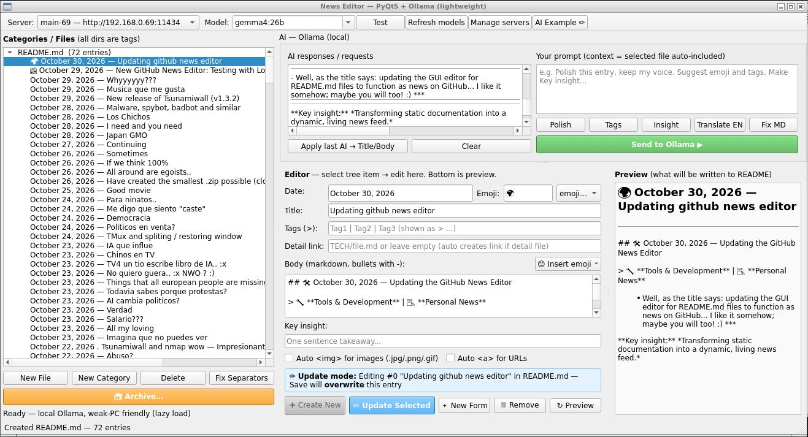

# 🌟 ═══════════════════ 🌟
# 📰  P E R S O N A L   N E W S   📰
# 🌟 ═══════════════════ 🌟

**Teaching People Ethical Mastery of Their Own Potential.**

---

> 💡 **General Principle:** *True consciousness begins with knowledge and skepticism.* 
> My project aims to guide humanity toward foundational wisdom, ensuring that our daily decisions—from how we spend money online to who we trust with our private data—are made from a place of informed clarity rather than panic or assumption.

> 📢 **Ideas are welcome:** *on irc.librera.chat channels:* #grandekos, #grandekos.com, #m5it, #tsunamiwall and rest (#programming, #python, #linux etc...)

---

## 🌍 October 30, 2026 — Updating github news editor

> 🔧 **Tools & Development** | 📝 **Personal News**

- Well, as the title says: updating the GUI editor for README.md files to function as news on GitHub... I like it somehow; maybe you will too! :) ***
- How to start: 
    a.) First install requirements.txt into new pip/python environment. 
    b.) source into new environment 
    c.) update pip (pip install --upgrade pip) 
    d.) pip install -r requirements.txt 
    e.) sudo ln -s $(pwd)/mystart.sh /usr/local/bin/githubnews 
    f.) githubnews 
 

**Key insight:** *Transforming static documentation into a dynamic, living news feed.*

---

## 📰 October 29, 2026 — New GitHub News Editor: Testing with Local Ollama

> 📝 **Personal News** | 🔧 **Tools & Development** | 🤖 **AI Integration**

- **Created a GitHub news editor**—finally giving my personal news a proper home.
- **Testing it out**—so far, so good. The editor is functional and responsive.
- **Added local Ollama support**—because why not? AI-assisted editing is a game-changer for keeping things concise and polished.
- **Screenshots attached** (news_editor1.jpg, news_editor2.jpg, news_editor3.jpg)—proof that it’s actually working!

**Key insight:** *Automation isn’t just about efficiency—it’s about reclaiming time to focus on what matters. Now I can write, refine, and publish with a little help from my AI sidekick.* 🚀

---

## October 29, 2026 — Whyyyyyy???

> 📝 **Personal Reaction** | 🌍 **World News** | 🤨 **Confusion**

- Mr. Donald Trump giving "Apache" helicopters to Morocco... OMG?? But why??? Are you angry with me or what?? Why??? :( I thought I liked you already... :x

---

## October 29, 2026 — Musica que me gusta

- El mato a un policia motorizado, Ninos mutantes y otros -> ( https://www.youtube.com/watch?v=NGbcypG1Rg8 , https://www.youtube.com/@n_mutantes , https://www.youtube.com/channel/UCdRYb7xOVq26BuXbAtSt4Fw )

---

## October 29, 2026 — New release of Tsunamiwall (v1.3.2)

- What's new? Archiving of log files. List, preview, open / close of old archives. ( https://github.com/m5it/tsunamiwall )

---

## October 28, 2026 — Malware, spybot, badbot and similar

- To have good security program for malware we will need at least one server with a lot of memory, not vram just dram.  
    So cheaper but simple computer like ours are not enough to load all malware hashes and it data. 
    There are ways to minimize IOC space by separating malware data depend on system configurations but for this we will need to plan, think a lot more.. 
    You and donations are welcome! 
- Ok, there is a way. From 1.3Gb of data have stripped out to 23Kb. This is useful! 

---

## October 28, 2026 — Los Chichos

- Good / Buena music_a => https://share.google/7ZQYikFAPxM4ITbqE

---

## October 28, 2026 — I need and you need

- I need work and you need me so write to w4d4f4k@gmail.com and maybe we can work together? Thanks a lot! 
    Blaz K. 

---

## October 28, 2026 — Japan GMO

- I think problem was/is always with people who work there like this these attacks can occure...

---

## October 27, 2026 — Continuing

- Continuing with KosWebCMS5 + KosDB on grandekos.com. KosWebCMS5 will replace current running php and nginx. nginx will serve only for balancing and domain redistribution.. 
    Then port a lot of php code for new cms as plugins.. 

---

## October 26, 2026 — Sometimes

- Sometimes i speak no so perfect and i am sory but better to tell then not.. :) 
    And who is perfect. Only our best friend AI IA SC 

---

## October 26, 2026 — If we think 100%

- Then there is no problem more with space! 
    Because all languages will transform into one like webasm.. :) 

---

## October 26, 2026 — All around are egoists..

- Searching for no egoist people... (programming, ideas and similar) you are welcome... *** 
    Nothing is simple... and harder is alone. 
    Because of this we think as 100% not 5...! 
    If they call us comunists because we like to work and help and live so everyone survive and have doctor or food or what is normal in this world then please listen to your self once before you talk to other... 

---

## October 26, 2026 — Have created the smallest .zip possible (cloudzip)

- As title says... Smallest .zip packed file possible... :) i call it .xpak (.czip <- maybe? :) ) instead of .zip 
    Work / Logic is used from chinese writings 
    Useful for open code projects. 
    I think we can reduce space for at least 60% - 70% 
    Also we get useful statistics 
    Also more work and updates are required with this workers! 
- Ex.: 
    t3ch@kosgen1:~/Working/Hobies/xpak$ cat sample.txt 
hello world
this is a test
hello world
this is a test
hello world
foo bar baz
this is a test
foo bar baz
hello world 
t3ch@kosgen1:~/Working/Hobies/xpak$ cat sample.xpak 
000100010002010200 

---

## October 25, 2026 — Good movie

- Dulces suenos aka Nice dreams (cheech and chong) <a href="https://www.imdb.com/es-es/title/tt0082163/">Nice dreams</a> 

---

## October 24, 2026 — Para ninatos..

- Basta con protestas! Caliente se con abrazo de mama y relax... 
    Y no solo por eso. Simple no puedes dejar que malos consigue que planea.. 
- Vida es bonita! Mucha jente eso no ve :( como me madre... TRabaja 43 anos y no ve como bonito esta mundo y vida. Sabe solo que quiere trabajar sin parar y no se siente bien... 
    Me digo que probable por eso... 43 anos.. Aqui normale jente no soporta 25... **** besitos a todas mamas que trabajan mas que necesita **** 
- Y yo tengo 43 anos... Significa que me madre empeso trabajar por me.. algo asi.. omg.. 

---

## October 24, 2026 — Me digo que siento "caste"

- Me dicieron que politicos cambian... Lol.. Cuando??? :D haha lol blabla

---

## October 24, 2026 — Democracia

- Democracia en guera...? Porque, no estamos uno? y que estamos? Mentira? Muchas gracias...

---

## October 24, 2026 — Politicos en venta?

- Que penso es que nouestros y de rusia y sur america politicos se venden... y chinos lo compro.. 

---

## October 24, 2026 — TMux and spliting / restoring window

- Very useful command to split terminal window to horizontal or vertical. <a href="TECH/tmux_spliting_and_restoring_windows.md">How to split and restore tmux window?</a>

---

## October 23, 2026 — IA que influe

- Buena idea. Podemos hacer "bots" que molestan a jente que sube a IRC y pregunta cosas para aprender algo nuevo. Eso es posible! :) 
    Este bot probable se va llamar "AbuelaBot" 

---

## October 23, 2026 — Chinos en TV

- Chinos en TV cuando pensas que estan follando en verdad estan llorando

---

## October 23, 2026 — TV4 un tio escribe libro de IA.. :x

- Dice algo que jente va estar todos lo mismos. Eso ya esta.. 95%... Libros en casa???? IA no va cambiar nada de eso.. pense en 95% y tienes respouestas para todo.. payacon 
    Que probable quiere decir tio de libro es que no quiere que 95% conoce eso que consoce 5%... :) 
    Todavia penso que depende mucho de familia y cercanos y eso no solo de IA que en un momento puede influir tanto a jente hasta que aprenden :)... 
    Cuanto veo jente normal veo que hasta no sepa que IA existe... 

---

## October 23, 2026 — No quiero guera.. :x NWO ? :)

- No es mas facil votar?... conjo

---

## October 23, 2026 — Things that all european people are missing out

- Noticing aswell: 
    The caste system in India is a ancient social hierarchy that divides society into hereditary groups based on birth, occupation, and ritual purity. 
    Well I am noticing this in Europe... :x 

---

## October 23, 2026 — Todavia sabes porque protestas?

- Penso que jente no sabe mas porque estan en calles... :x 
- Probable creaste un par de terroristas con estos protestos. En un par de anos cuando jovenes crece vamos ver vuestro trabajo.... De policia y politicos que conseguiste con eso... 

---

## October 23, 2026 — AI cambia politicos?

- No hablo de eso.. todavia y espero que para siempre vamos tener personas que elije ultimo! Pero AI es para ayudar y que cosas van mas rapido... y mas... hay monton de buenos.. buenos.. pues buenas cosas con AI IA... ****
- Tambien va ayudar con corrupcion.. Penso asi.. 
- Que veo es que viejos no valen que hablan de future de jovenes... Veo asi... 

---

## October 23, 2026 — Verdad

- Que jente pensa no importa, importa solo verdad! 
- Sin verdad hasta aeroplanos no va poder volar.... :x 
- Aora en TV5 Victor Camina. Me gusta apeido y que estas hablando hombre... Penso que me gusta... *** necesito te escuchar un par de veces mas pero penso que me gustas! :D 
    Hay muchos que me gusta pero quidado con nervios... *** 

---

## October 23, 2026 — Salario???

- No pensas que es tiempo cambiar eso????????? ???????? ??????????

---

## October 23, 2026 — All my loving

- <a href="https://www.youtube.com/watch?v=TSpiwK5fig0">The Beatless - All my loving</a> 

---

## October 23, 2026 — Imagina que no puedes ver

- Imagina que no puedes ver. Que vas sentir? o como vas saber quien es quien o quien es buena persona etc... 
    Estos sentimientos en tiempos asi que tenemos nos va venir muy bien... 
- Yo penso que nadie es malo. Por lo menos no nacido malo. Que lo hago mundo en vida es otra pregunta... 
 

---

## October 22, 2026 . Tsunamiwall and nmap wow — Impresionant how tsunamiwall notice nmap... incredible!

---

## October 22, 2026 — Abuso?

- Abuso? :D

---

## October 22, 2026 — Estan copiando a nosotros pobres

- Estan copiando sin saver que estamos. Sin respetar. Nos ensuenan que payacos estamos.. Puess eso va cambiar aora! Lo dejiste ustedes! Derecha! Payacos. 

---

## October 22, 2026 — Pide profesor, pide campbesino pide amigo.. pide vecino..

- Title.. estamos juntos.. eso paso en pasado... que pide uno y pide otro.. pero estamos juntos..

---

## October 22, 2026 — Nano bots VS THC bots

- Nano bots for ordinary people dont exists and THC bots si... so... dont burn just eat.. :D

---

## October 22, 2026 — Protests...

- I don't think this is good if continue like is happening now. Looks like school for protesters man... Be careful with future!

---

## October 22, 2026 — Just thinking... Go, Rust, Python, C... hmmm

- So, thinking and comparing. I see to create some apps in Go will be super good looks like...

---

## October 22, 2026 — Milei think he is kind of Mr. Trump

- Well milei you are just payaco

---

## October 21, 2026 — Agresion, violencia, motosiera etc

- No me gusta! motosiera si porque vale para cortar madera.. pero con cabesa.. :x payacones... conjo...

---

## October 21, 2026 — More about these violations

- What i am noticing is that these people who can do what ever they want they dont know a lot. They are scared too fast and they need other people for explanations...
- How to protect? 
    1.) Use expensive providers like Amazon. 
    2.) Or encode disk 
    3.) Or encode projects ( https://github.com/m5it/xenco ) 
      Encode on reboot. 
    4.) systemd-nspawn with encription. 
      Luks 
      cryptsetup 
 
Hiding of data is not so simple looks like because if we encode something it is impossible to execute it later.. :) So this are interesting projects for thinking... *** :) 
More on how to protect raw systemd data <a href="TECH/systemd_protect_raw_data.md">check here</a>. 
 

---

## October 21, 2026 — Contabo and recommendations

- I recommend you to not help kind of faschist people. for money or what ever... well i know you wont listen to me. People you need to secure your self because when these want something they get...

---

## October 21, 2026 — Github and password and contabo and... faschists

- If something have password on github on x repo means he dont like you access it. then you get access to my disk images of contabo this makes you faschist... at least i see it that way... 
    Because of this going to increase security. 

---

## October 20, 2026 — Kernel 7.3 for low VRAM AMD

- Something interesting they say ( https://www.xda-developers.com/linux-73-is-out-with-some-nice-improvements-for-people-with-low-vram-amd-cards/ )

---

## October 19, 2026 — Tsunamiwall and it bugs. (fill the harddisk) [High]

- Working on — Log backups aren’t capped. rotate_hit_log accepts max_backups, but the rotation logic shifts existing backups upward without deleting backups beyond that limit. Repeated rotations can still fill the disk. 
    Also we need good idea how to prevent this... 
      1.) Notices to user? 
      2.) Auto compress /var/log/tsunamiwall/bycountry each day and save stats for display as log? 
      3.) Ideas are welcome... 
      4.) Configure limits trough config.yaml 
- There are more tasks to work on and require ideas so you are welcome always! 
 

---

## October 19, 2026 — How does people survive

- How do you survive? Not you with families, jobs, grandmoms and pups... No. How do survive people without that? Well... lets think... 

---

## October 19, 2026 — How I think..

- Look if one day we update apparmor and in two days you have same update means something was wrong in first update... :)

---

## October 19, 2026 — Contabo is restarting our server as they like

- WTF... well yesterday happened and today on another server.. What is this. 
- It take 13min this restart. I think someone created disk image and later search on my data. 
    Why? 
    Good question. 
- Now trusting contabo less then before... Recommend dont trust... Like this is when you need to satisfy with the cheapes things.. 

---

## October 19, 2026 — To develop faster

- I think if we wana our world, system is developing faster we need to remove money... :) Important is everyone is doing what he love to do... 
    If someone wana be stoned until he is dead.. do it 
    Who love to work he will work anyway... 
 

---

## October 19, 2026 — Loop that can secure your system

- As title say kind of magic line..: 
    sudo lsof -n -i -P | awk '/ESTABLISHED/{print $0}' | grep ":22->" 
   
  Imagine this line in loop. Like this we can check who is connecting trough ssh to our server. If we put this into 2sec loop and check IP who is connected aswell we need a list of allowed ips. 
    If script notice IP that is not allowed we can simply DROP it with iptables and the day is safe... 
   
  We could kill the process aswell instead of DROP the ip.. 
   
  Tsunamiwall stats if someone is interested: <a href="tsunamiwall.stats.19.10.26.txt">tsunamiwall.stats</a> 

---

## October 18, 2026 — I love python ctypes

- With ctypes we can create libraries in rust or c/c++ to include and hide code in python... ***

---

## October 18, 2026 — What you notice with tsunamiwall

- With tsunamiwall you can notice increase of scans on ports 23 and 445. Why? Because there are new/old vulnerabilities created exploits...

---

## October 17, 2026 — Nginx and flaws

- Looks nginx released some bug fixes but they are still present in old versions just new have updates so.. good luck or how to say... ***

---

## October 17, 2026 — Github and refresh of page

- Github, how many times you need to refresh this f.... page before it gets viewable... ? what is this??? this is future of pages or what? :D lol 

---

## October 17, 2026 — Avocado price

- Avocado price one kg 12Euro and more.. Once avocado cost me 3.6Euro... :X 
    Today one spoon of guacamole cost 50cents! Payacos de mierda de cojones 
    Parazito suena mejor para estos... payaco es bonito conjo.. 
    How many people live on world, or in spain?? lol you dont know... because you look at your ass and no ass more.. 
    Before people call this kind of people: asshole 

---

## October 16, 2026 — Good movie

- El ultimo samurai en pie (Last samurai standing) https://www.imdb.com/es-es/title/tt38069160/

---

## October 16, 2026 — Tio que se siente mejor de todos en mundo

- Este tio pensa solo en quotas

---

## October 15, 2026 — Difference between european and asian womans

- If man buy cats food in shop and there works european woman, she will think this guy is why.. :D On other part
    there works chinese woman, she will think this guy have some problems.. lol ;D

---

## October 14, 2026 — Nan Madol / Indonesia

- If we look good at this island you can notice that the level of the sea went up... This means this island need to be old and very old...

---

## October 14, 2026 — Some think these pages are worth to observe...

- <a href="worth_to_observe.txt">worth to observe/monitor</a>

---

## October 14, 2026 — Programming on walls of the house

- Years ago a lot of years ago when we travel to the coast with family and there was no electricity no computers and similar. I decided to write programs in c++ to the walls of the house.. I remember i wrote client and server stuff in c++ to the wall of room.. :)

---

## October 14, 2026 — Trademarks and wtf we need all this stuff

- :) This world is not for us i see..

---

## October 12, 2026 — Important day for Spain!

- Today looks super important day for Spain. "Dia de nacionalidad". Got a lot to say but my mouth are closed... Anyway wish all good to the Spain and World. *** Besitos.

---

## October 9, 2026 — Investigadores que estuvo despedidos de OpenAI

- What I am thinking these three guys was kind of "testigos de jejova" or "mormones" or this similar... thing then you know why they can not work in company like OpenAI. I understand if you is another question... Kisses to all untrusting people...***

---

## October 8, 2026 — Showing with finger but no positive ideas, words, sentences etc...

- On TV showing with fingers one to another but to search for solutions dont happen...  
    Kisses from my soul to all TV *** 
 

---

## October 8, 2026 — Maricarmen Abascal digo

- Son unos inhumanos. 
    Me abuelo digo: son animales con dos pies 

---

## 🗳️ October 8, 2026 — Who Gets to Vote? Residency vs. Belonging

> 📺 **TV Debate** | 🗳️  **Voting Rights** | 🏠 **Residency & Politics**

- 📺 **Watching the news.** Three guests, one question: *who is allowed to vote?* Nobody answers it simply. Everyone argues. I'm on the couch, slightly annoyed. :)
- 🧠 **My baseline is simple.** You live in the country, you vote. You think you *should* be there, you vote. You're not living there, not part of the day-to-day — well, 
*normally* that option doesn't exist. End of story, right?
- 🤔 **…Except it's not.** A diaspora kid grew up in a different language. A worker abroad pays into a system they can't influence. "Normally can't vote" gets weird when you 
actually meet the person behind the rule. So yeah — *more complicated than this.* :)
- 🗣️  **And yet on TV** it's framed as a yes/no, a red/white line. "They *should have* the vote." "They *can't* have the vote." Nobody says: *"It depends, and here's why it's 
hard."*
- 📌 **TL;DR:** I side with "live here, vote here" as the starting rule. But I also know that one sentence doesn't cover every human who ever left, stayed, or got stuck in 
between. The debate on TV missed that.

---

## 🏛️ October 7, 2026 — "Flaccus" Was Just a Guy with Floppy Ears

> 📜 **Ancient Rome** | 🦻 **Etymology** | 😄 **Name Shame**

- 📰 **The name "Flaccus" — which sounds like a stern consul's seal — literally meant "big floppy ears" or "fatty."** Not a virtue. Not a title. A face.
- 🏷️  **Rome named its kids after body parts.** *Brocchus* (b
- <a href="bullying_already_in_time_of_roma.md">Bullying already in time of Roma</a> ? :)

---

## 🌿 October 7, 2026 — A Quiet Day

> ☕ **Personal** | 📺 **Calm** | ✨ **No Headlines**

- 🌤️  **No news today. No breaking stories, no geopolitics, no AI regulation drama.** Just… a day that hasn't happened yet.
- 🤞 **Wish for today:** new opportunities, love, light. The small stuff. The good stuff.
- 📺 **Main decision of the day:** Turn the TV on? Or let the day just… flow. Both feel right. Neither is urgent.
- 🕊️  **No source needed.** Sometimes the only "article" is the one you don't write.
- ✨ **The irony (gentle edition):** After a week of locked-down LLM ports, `.gitignore` cleanup, and AppArmor logs — the most important news entry is *"nothing. and 
that's okay."*

---

## 📺 October 4, 2026 — Brahma Kumaris on TV6… :D

> 📺 **TV / Media** | 🧘 **Brahma Kumaris** | 🤷 **Mild Existential Confusion**

- 🧠 **"Limpiando el cerebro, pero solo a la gente que se deja limpiar… Normal, gente con problemas."** Yes. That was the vibe. You're not *cleaning* brains, you're 
*curating* who gets a brain cleaned.
- ⚠️  **¿Estamos hablando de secta?** I have no idea. I genuinely do not know. I sat there, nodded, and my internal wiki-page was blank. *Lol.*
- 🤷 **The whole segment passed over me like I wasn't even in the room.** I don't know where to start. I don't know who's who, what the "technique" is, why it's on TV6 on a 
Saturday, or whether the woman in the white sari was being interviewed or was *the* interview.
- Wow... Listening to this woman.. you see she is dangerous.. ! :D this is my comment.

**Key insight:** You don't owe a spiritual organisation your attention just because it bought 4 minutes on TV6. And "I didn't follow the whole thing" is not a character flaw 
— it is a *valid response* to a 200-year-old meditation movement compressed into a news-break segment. You are allowed to be the alien. You are allowed to do the thing.

---

## ⚡ October 3, 2026 — Half the Island in Darkness

> ⚡ **Infrastructure** | 🏝️ **The Island** |  🔌**Power Outage**

- ⚡ **Half the island was without electricity at 6 AM.** No warning. No rolling notice. Just dark, and the hum of the grid gone.
- 🔌 **And my UPS — the one thing I'd prepared for this — failed.** Not because it was old. Not because the surge fried it. Because I never wired the 
input correctly. One cable. One small, stupid, avoidable mistake.
- 🤦 **The irony stings more than the blackout.** A regional infrastructure failure took out half the island. *My* failure was a mis-seated 
connector. And the small one cost me more, because I was the one sitting in the dark at 6 AM expecting the backup to carry me.
- 📋 **Filed, not forgotten:**
  - Re-seat and *verify* the UPS input cable. Label it.
  - Do a full load-test before I trust it again (5-min run under real load, not just "LED is green").
  - Call the utility, report the outage, ask for the restoration window.
  - Text two neighbours to check if it's isolated or island-wide.
  - :)

**Key insight:** On an island, the grid is not a utility — it is a lifeline. And a backup you never actually tested is not a backup. It is a promise 
you made to yourself on a Tuesday and forgot by Thursday. The grid can fail on any of you. You can only make sure your own one doesn't.

---

## Oktober 1 or 2 (not sure), 2026 — Alicia del Rio muy bien dicho!

- Que hace politicos es sembrar miedo para protejer su culo! 
    Y eso no vale para jente y tampoco para companias... :) 
     
    Cuando jente tiene problemas no puede pensar en que hay que pensar... como adictos... Hay mucho rasones porque AI or IA or SI puede funcionar mejor como politico que verdadero/en momento politicos... 
     
    No tiene nada que ver con comunismo o fascismo o nacismo o democracia o.. estas cosas del pasado... 
