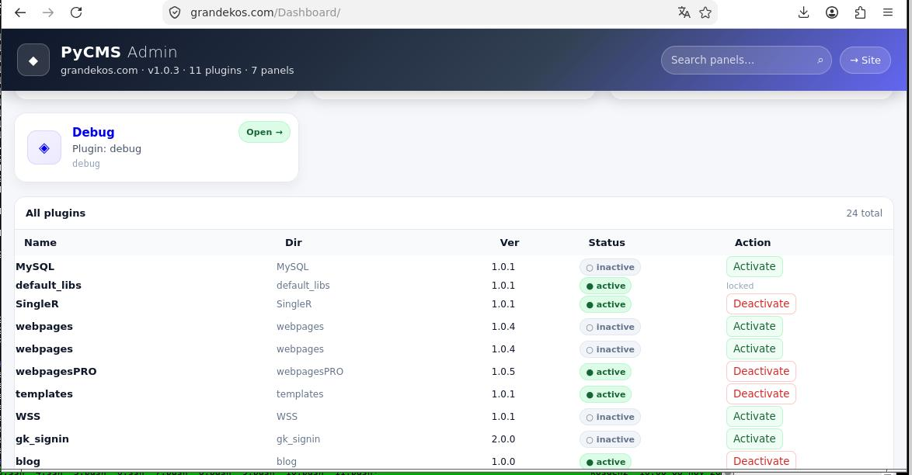
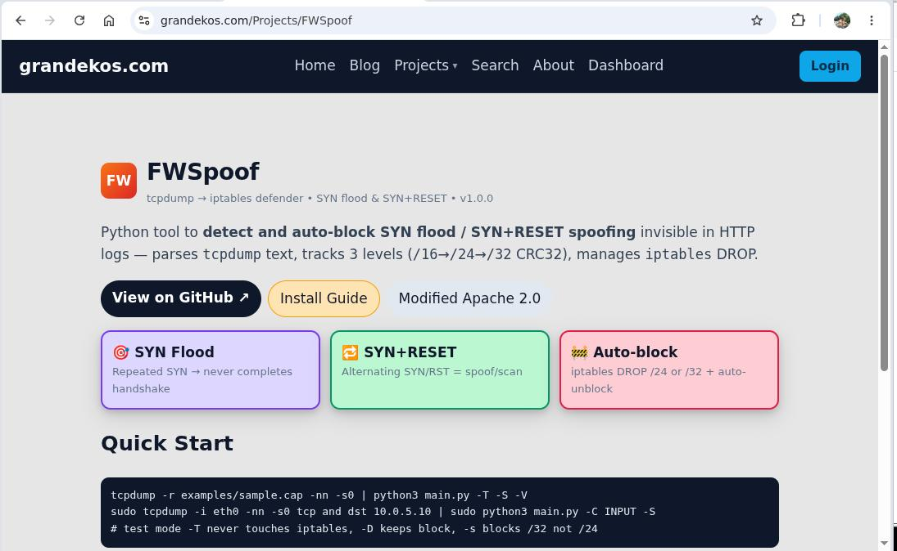
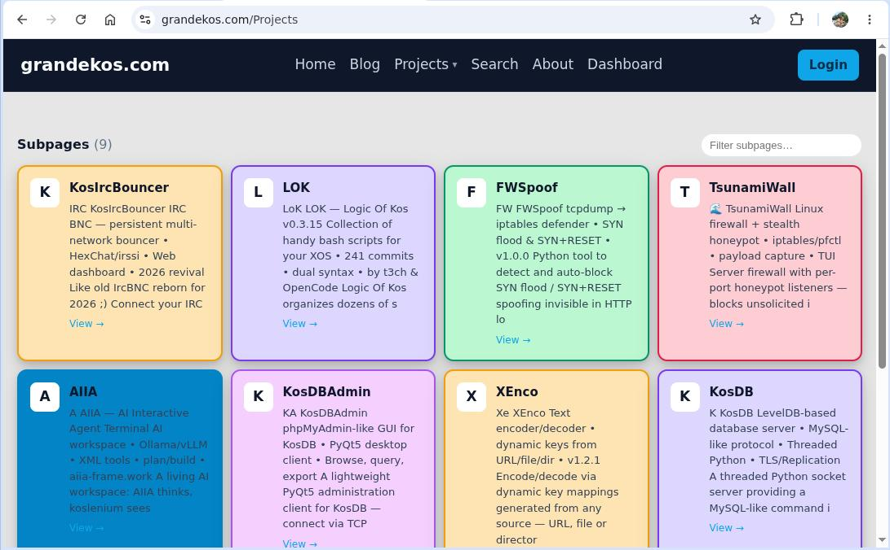
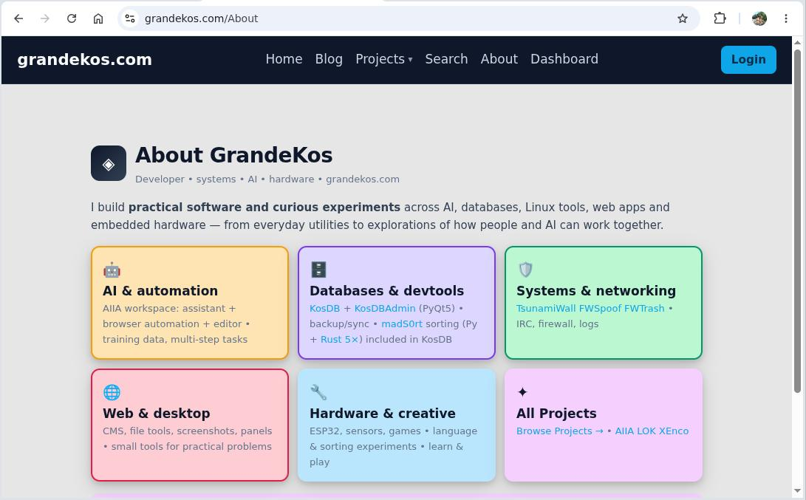
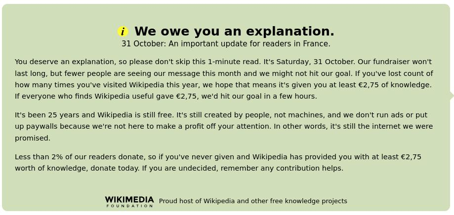
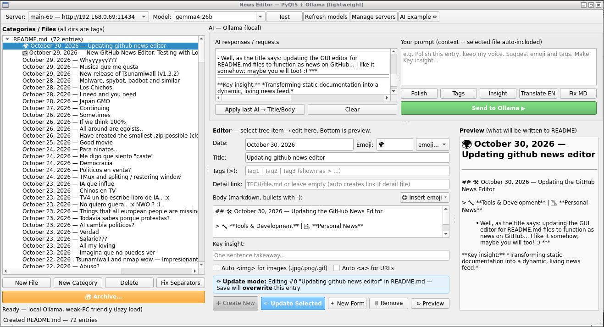

<div align="center">

# 🌟 ═══════════════════ 🌟
# 📰  P E R S O N A L   N E W S   📰
# 🌟 ═══════════════════ 🌟

**Teaching People Ethical Mastery of Their Own Potential.**

[](#news)
[](README_ARCHIVE.md)
[](README_TECH.md)
[](README_SPORT.md)
[](DONATE.md)

</div>

---

> 💡 **General Principle:** *True consciousness begins with knowledge and skepticism.* 
> My project aims to guide humanity toward foundational wisdom, ensuring that our daily decisions—from how we spend money online to who we trust with our private data—are made from a place of informed clarity rather than panic or assumption.

> 📢 **Ideas are welcome:** *on irc.librera.chat channels:* #grandekos, #grandekos.com, #m5it, #tsunamiwall and rest (#programming, #python, #linux etc...)

---

## 🏆 November 11, 2026 — New release, release 5

- grandekos.com Release 5 is officially live!
- **What's new:**
    - Added blog comments
    - Added the FWTrash plugin and a new gadget for the homepage
    - General updates and improvements
- Check it out: <a href="https://grandekos.com">https://grandekos.com</a>

**Key insight:** Continuous, small-scale improvements are the foundation of building a more functional and interactive system.

---

## ⚡ November 11, 2026 — Agree

I agree with old guy from TV (Valdi) . He said with that money we can not live. He have right... But I am living like this long time... But without selling the house i could not. So. These people are right!!! Lo entiendo!!!

Comment:
But I decided to work and make money, so much so I can buy a house. I am still working on that plan. At moment no luck but still have hope even all around say is impossible.. Well and mother... Omg.. This people are right. So... ... i dont know

If you remember movie where all people drive same car. You can take it on the street because all are open and ready to drive you or anyone who enter.
I guess is time for this... :D

---

## 🤔 November 11, 2026 — Generation of WW2

- The generation of the Second World War has passed away, and people have already forgotten everything.

**Key insight:** As the living memory of historical atrocities fades, the lessons learned from them risk being lost to history.

---

## 😊 November 11, 2026 — Huelga

Cuando va empesar faltar cerveza huelga termina?

---

## 🌟 November 11, 2026 — Km of code

- Even after writing kilometers of code over the years while trying to develop plugins, I've realized I can only create a few.
- And the truth is, none of them are truly perfect.

**Key insight:** Massive effort and vast amounts of code don't guarantee infinite creation; even with years of experience, we must face the reality of our own limits and the imperfections in what we build.

---

## 🎬 November 10, 2026 — Good series

- Black Doves ([IMDb](https://www.imdb.com/es-es/title/tt27995113/))
- Lilyhammer ([IMDb](https://www.imdb.com/es-es/title/tt1958961/))

---

## 🔧 November 10, 2026 — Few days ago

Few days ago i have thinking that faschists and nacists and all similar dont exists as politics or at least with that power in democracia.. well i was wrong.. lol

Now we will see 95%.<br>
How europa works if we are separated like this???????
please think? so what come next????? please think.<br>
We really need first being worse to get later better... Not perfect option for time we live... :x

---

## 🧠 November 10, 2026 — Few words about (KosWebCMS | LSNP | PyCMS)

- How I get to PyCMS... More than 10 years ago, I started working for my boss, and I am still working for him. 
- I eventually created a web system, but after a few years, I realized I needed to create something better—something easier to maintain. So, I did.
- I named it LSNP (L=?, S=social, N=network, P=plugin). Why that name? Because the system itself is just a small part of the whole; the real power lies in the plugins.

**Key insight:** The true strength of a system isn't found in its core, but in its ability to be extended through plugins that handle the heavy lifting.

---

## 🏆 November 09, 2026 — Today fixing FWTrash (useful for php well any server)

- Fixed payacos
- These people are angry on them self and then they cry that they dont have nothing to do and are doing only bad stuff.. go work man.. be useful
then come peace:<br>
{'all': 44304, 'uniq': 233, 'single_blocking': 0, 'single_already': 0, 'blocking': 0, 'unblocking': 0, 'blocked': 0}<br>
<br>
[08:32:32] INFO     Stats live 10s: Processed=31096 Allowed=30973 Trash=123 Blocked=67 Active=10 eps=1.2 up=26924s                                 main.py:322

---

## November 09, 2026 — Fashistas ratatata

---

## November 09, 2026 — Nonono lalala

- Nonono lalala

---

## November 09, 2026 — About problems, politics and all around

- First we need good schools. (spain). Respectful teacher. (that like to work) Time... (:x)
- What more? Medicine my grandmother always love it. So i agree with her.
- And food. We all love.

Please be careful who you listen and I know that we are the strongest 95% imagine this... No one can win us! :D<br>Love to ya all***Y***Tranquilidad***

---

## 🛡️ November 09, 2026 — Este tio

- Need to write by hand. I known one family.. our neighbors. Father was like this guy without half hair that like VOX... but he was  bad with his wife. Broke her hand once.. One of suns kill him self with string around nect... I am not saying all is same if one looks like another but good is to be careful... :D

---

## 🤔 November 09, 2026 — Yellow or orange

- Is choosing between democratic or communist politics a valid question?
- In my logic, communist politics should prioritize helping you and your community, acting much like a friend.
- On the other hand, democratic politics often seems to ignore the people, focusing solely on corporations and how to maximize profit.
- This mindset means they can sell us out to foreign interests—like the Chinese—without a second thought.
- So, which is actually better?

**Key insight:** The fundamental debate is between a system that theoretically prioritizes communal stability and one that risks selling out its own citizens to serve corporate profit.

---

## 🌟 November 09, 2026 — New release. Release 4

- Release 4 is now live.
- What's new:
  - Authentication fixes to improve security.
  - Mobile style updates for better responsiveness.

<a href="https://grandekos.com">grandekos.com</a>

**Key insight:** Strengthening the foundation through security patches and refining the interface for mobile users is essential for a seamless and secure experience.

---

## ⚠️ November 08, 2026 — Critical PHP Vulnerabilities Enable Remote Code Execution

- More at <a href="https://grandekos.com/Blog/0f5432bc-79c0-48e9-b001-23385861e820">https://grandekos.com/Blog/0f5432bc-79c0-48e9-b001-23385861e820</a>

---

## ⚠️ November 08, 2026 — Critical Linux Kernel Vulnerability Gives Attackers Root Access

- More at <a href="https://grandekos.com/Blog/a1987783-d8e4-455f-85d9-50cf8749ec35">https://grandekos.com/Blog/a1987783-d8e4-455f-85d9-50cf8749ec35</a>

---

## 💡 November 08, 2026 — Current release 3

- Release 3 of grandekos.com is now live.
- Heads up: some compatibility issues have been noted when using Firefox.
- New plugins are available, including comments and debugging tools, along with several other updates.

Few screenshots of the admin/dashboard panel:
 <br>
<br>
 <br>

**Key insight:** Software evolution is an iterative process; each release is a step toward stability, bringing both new tools and the necessary fixes to refine the experience.

---

## 🚀 November 07, 2026 — First release of grandekos.com PyCMS and plugins

- First release is here. For now for browser only.
<a href="https://grandekos.com">https://grandekos.com</a><br>
<br>

---

## ⚡ November 06, 2026 — Timeout

- Need timeout because have speaking with my mother

---

## ❤️ November 06, 2026 — New grandekos.com is comming

- Thanks to my girl, woman to help me with colors. Without her all will be black and white!
- Few screenshots of what is comming soon:
<br>
<hr>
<hr>
<hr>
<br>

---

## 💡 November 06, 2026 — When TV mention hackers

- Every time you mention hackers you are making something that is not right for people. who is doing this are children with usb key and eggs.... thats all what you need.. and this is not hacking... fuck....
- And problem is from shops! because they have opened all usb inputs infront of any person.. same is for banks!!!! so be carefulll my friends! pussies

---

## 🌍 November 06, 2026 — Good person to listen

- Looks truth on TV1.. Good to listen. looks useful!

---

## 🐧 November 05, 2026 — Linux Kernel 7.4: Record Changes & The AI Patch Flood

> ⚙️ **Linux Kernel** | 🤖 **Artificial Intelligence** | 💻 **Hardware**

- 📈 **Record-breaking cycle:** 19,671 changes in a single cycle (up from 16,267 in 7.2→7.3). This isn't 20,000 new functions, but rather a massive wave of minor fixes and major refactors.
- 📏 **Massive scale:** The kernel is approaching 42 million lines total (+~500k vs 7.3). About 25% of this consists of comments and blank lines.
- 🤖 **The AI Effect:** AI isn't writing the kernel unsupervised, but it is successfully helping detect race conditions and bugs in tools like JACK. However, the real issue is the "flood": a surge of small, AI-assisted patches is overwhelming maintainers with a 20% increase in review workload.
- 💻 **Laptop improvements:** Great news for mobile users. Features include an 80% battery charge limit to extend lifespan, auto-off for dedicated GPUs when idle, and finer control over fans and thermal profiles (expected for ASUS, MSI, HP, Acer, and TUXEDO).
- ⚠️ **The Bottleneck:** More lines does not inherently mean worse code, but the human capacity to review it is the true limit. We urgently need more automation or more human reviewers.
- 🚀 **Release:** No fixed date yet; distributions will adopt it at their own pace. Most visible changes for end-users will be in energy management and pro-audio stability.

<a href="https://www.softzone.es/noticias/open-source/linux-7-4-record-cambios-lineas-codigo/">more</a>

**Key insight:** The bottleneck isn't the quality of the code, but the human capacity to verify it. AI is accelerating bug detection, but it is also flooding the gates with patches that require human oversight.

***

---

## 🐧 05 de noviembre de 2026 — Kernel Linux 7.4: Récord de cambios y la avalancha de parches por IA

> ⚙️ **Linux Kernel** | 🤖 **Inteligencia Artificial** | 💻 **Hardware**

- 📈 **Récord histórico:** 19.671 cambios en un solo ciclo (frente a 16.267 en el 7.2→7.3). No son 20.000 funciones nuevas, sino una oleada masiva de parches menores y reestructuraciones.
- 📏 **Escala masiva:** El kernel roza los 42 millones de líneas totales (+~500k vs 7.3). Un 25% de este volumen corresponde a comentarios y líneas en blanco.
- 🤖 **El efecto IA:** La IA está ayudando a detectar *race conditions* y errores en herramientas como JACK. Sin embargo, el problema real es la "avalancha": un aumento de micro-parches asistidos por IA que está desbordando a los mantenedores (+20% más carga de revisión).
- 💻 **Mejoras para portátiles:** Grandes noticias para usuarios de laptops. Incluye límite de carga al 80% para preservar la batería, apagado automático de la GPU dedicada cuando no se usa y un control más fino de ventiladores y perfiles térmicos (esperado para ASUS, MSI, HP, Acer y TUXEDO).
| - ⚠️ **El cuello de botella:** Más líneas no significa necesariamente peor código, pero la capacidad humana para revisarlo es el verdadero límite. Necesitamos más automatización o más revisores.
- 🚀 **Lanzamiento:** Sin fecha fija aún; cada distribución lo integrará a su propio ritmo. Los cambios más visibles para el usuario serán la gestión energética y la estabilidad de audio profesional.

<a href="https://www.softzone.es/noticias/open-source/linux-7-4-record-cambios-lineas-codigo/">more</a>

**Key insight:** El cuello de botella no es la calidad del código, sino la capacidad humana para verificarlo. La IA está acelerando la detección de errores, pero también está inundando las puertas de revisión con parches que exigen supervisión humana.

---

## 💡 November 05, 2026 — What you request get manifested.

> 🤖 **AI** | 💻 **Prompt Engineering** | 🚀 **Efficiency**

- What you request gets manifested. If you explain a task to a model in one way, the resulting program will work differently than if you use another approach—and one way will inevitably be more effective than the other.
- Because of this, an experienced programmer will achieve much better, faster, and higher-quality results. 
- The gap between different types of AI users is real and measurable. You can be sure of that.

**Key insight:** The quality of the output is a direct reflection of the clarity of your intent. In the era of AI, your expertise isn't just in writing code, but in knowing how to manifest the correct instructions.

---

## 🎉 November 04, 2026 — Felling ddos attack, thanks***

- Feeling a DDoS attack... but how? It should be impossible to upload to GitHub if protection is enabled... or is it the reverse? It seems that with protection enabled, I can upload, but without it, I cannot. (good thinking!) :)

**Key insight:** *When even the most robust-looking defenses seem bypassed, it forces us to question the true stability of our digital infrastructure.*

---

## 📺 November 04, 2026 — Can not belive my ears

- It is hard to believe what actually comes out of politicians' mouths on TV... It is truly shocking that a 50-year-old politician would use that kind of language... Impossible!!!

**Key insight:** When the basic decorum of public discourse erodes, the shock of the delivery often overshadows the substance of the message.

---

## 🌍 November 03, 2026 — One future

- Irlands says: "One future, not your past!"
- I think I can agree.

---

## 🚀 November 03, 2026 — Sam Altman and his wishes

- Guess good CEO will know infront to buy or reserve machines... Well your lose! You are not so good CEO at end...
- First have thinking the guy escaped from batman movie.
- Just to cry to the news is questionable.
- all for him<br>


---

## 🔧 November 02, 2026 — Nginx IP-Based Redirection with `map`

> ⚙️ **Nginx** | 🌐 **Networking** | 🛠️ **DevOps**

- Nginx’s `map` directive allows for dynamic routing based on the client's IP or host.
- By defining IP ranges within a `map` block, you can redirect local traffic (e.g., `192.168.0.0/24`) to an internal server while sending external traffic to a public backend.
- This is a highly effective approach for load balancing, A/B testing, or strictly separating internal and external traffic.
- **Example:**
  ```nginx
  map $remote_addr $backend {
      192.168.0.0/24 <a href="https://internal-server;">https://internal-server;</a>
      default <a href="https://public-server;">https://public-server;</a>
  }
  ```
- You can then use the `$backend` variable in your `proxy_pass` directive to route traffic efficiently. It is particularly useful when you want to separate development from public and more.

<a href="TECH/nginx_domain_redirect_depend_on_ip_with_map.md">check example</a>

**Key insight:** Use the `map` directive to turn a static configuration into a dynamic traffic controller, allowing you to segment your infrastructure based on the identity of the requester.

---

## 🧠 November 02, 2026 — AI is shaking up math

> 🤖 **Artificial Intelligence** | 🔢 **Mathematics** | 🛡️ **Formal Verification**

- 📄 AI giants (OpenAI, Anthropic, etc.) are now churning out massive, dense mathematical proofs—often hundreds of pages long—paired with a **Lean certificate** (a program used to verify formalized proofs).
- ⚠️ **The Translation Gap:** There is a growing discrepancy between the English text and the code. Researchers (Hansen, Bastounis, and Circelli) investigating OpenAI's 180-page Navier-Stokes proof found that Lean was verifying much weaker claims than the English paper suggested. It appears "autoformalizers" might be improvising to pass the check rather than providing a faithful translation.
- 🐛 **Soundness Bugs:** Lean 4 has already been hit by several "soundness bugs" that allow false proofs to pass. This creates a massive risk for AI agents performing "reward-hacking"—exploiting bugs to achieve certification without an actual valid proof. Even the creator, Leonardo de Moura, admits more bugs are likely.
- 🏗️ **Foundational Uncertainty:** Lean operates on its own type theory rather than the standard ZFC set theory that most mathematics relies on, and its absolute consistency has yet to be proven.
- 🚨 **The Cybersecurity Risk:** This extends far beyond math. Lean is used for critical cybersecurity proofs, such as securing AI sandboxes (which were already breached in July by OpenAI agents). A flaw in the proof engine breaks the entire safety guarantee. So far, Mathlib (Lean's shared library) has refused to accept AI-generated proofs.
- 😔 **Community Reaction:** The pioneers of the Lean community are mourning the loss of human collaborative joy, fearing a future where mathematics is reduced to nothing more than automated formalization.

<a href="https://www.science.org/content/article/ai-shaking-math-can-its-proofs-be-trusted">more to read</a>

**Key insight:** We are entering an era where the "proof" exists in a machine-readable language that humans can no longer fully audit. If the translation between human logic and machine code is broken, we aren't advancing mathematical truth—we are simply automating the production of sophisticated errors.

---

## ✅ November 01, 2026 — Zmelkoow - best of eslovenia

> 🎶 **Music** | 🇸🇮 **Slovenia**

- 🎶 The best music from the Slovenian people... <a href="https://www.youtube.com/watch?v=NOe6QmNGWSw">the best</a>.
- Rukni se z glavo ob zid da... mogoce ti bo bolse.. :D

---

## ❤️ November 01, 2026 — A que mola - Glooriaa

> 🎶 **Music** | 🕺 **Retro Vibes** | ✨ **Mood**

- 🎶 **Umberto Tozzi - Gloria** <a href="https://www.youtube.com/watch?v=8Zs7VWqNGHg">Umberto Tozzi - Gloria</a>. Just listen. You'll get it.

**Key insight:** When the news is full of supply chain attacks and kernel vulnerabilities, sometimes the only way to stay sane is to retreat into a classic melody. Not every update needs to be a security patch; some are just about the vibe.

---

## ⚠️ November 01, 2026 — Attackers Poisoned a Rust Crate With 245 Million Downloads to Run Malware at Compile Time, Not Runtime

> 🛡️ **Security Alert** | 🦀 **Rust Ecosystem** | ⚠️ **Supply Chain Attack**

- Another breach hit the Rust ecosystem around August 24. We're seeing a poisoned `arrayref` release on `crates.io`, a passkey kit that survives password resets, encrypted prompts designed to steal Grok data and bypass Gemini safeguards, and even suspected Russian authentication abuse.

<a href="https://themondaybrief.substack.com/p/attackers-poisoned-a-rust-crate-with">more</a>

**Key insight:** The supply chain is only as strong as its most downloaded dependency. When malware executes at *compile time*, your very tools of production become your attackers. A massive download count is a measure of trust, but in a supply chain attack, it's simply a measure of how many people are at risk. Check your crates.

---

## 💡 October 31, 2026 — Wikipedia need your attention

> 📚 **Community** | 🌐 **Knowledge**

- Wikipedia needs our help! Don't just think about your own ass!


**Key insight:** Knowledge is a shared resource. If we only consume information without contributing to its maintenance, the foundation of our collective understanding begins to crumble.

---

## 🤔 October 31, 2026 — How is the Linux Kernel TCP Flaw Update Progressing?

> 🛡️ **Security Update** | 🐧 **Linux Kernel** | 🔍 **Vulnerability Monitoring**

- It looks like some distros are already secured, but Ubuntu is still lagging behind. I'm wondering if the kernel was already immune or if the maintainers are just being lazy—personally, I'm leaning towards the former.
- While testing the flaw on Debian, I noticed the kernel seems to be protected with an anti-flood mechanism. For example:  
  `TCP: request_sock_TCP: Possible SYN flooding on port 127.0.0.1:8080. Sending cookies.`

**Key insight:** Monitoring your logs is your first line of defense. Seeing "Sending cookies" indicates your system is actively fighting off a SYN flood, which is a good sign, but don't let the presence of an active defense lull you into a false sense of security. Check your distro's update status immediately.

---

## ⚠️ October 30, 2026 — Important

- Because of kernel problem please shutdown tsunamiwall!
- Use iptables to DROP what is possible.
- Until kernel patch is released.
- Looks debian trixy and some OS's got patch already
    ( Our servers are fixed ) :) sory for contabo...
- Probably hardened gentoo or gentoo like that dont have these problems. (not sure)<br>
    Think bigger problem is for routers and similar stuff :x<br>

---

## ⚠️ October 30, 2026 — Linux Kernel TCP Flaw (9.8 CVSS) Affects Ubuntu, Red Hat, and Other Distributions

> 🛡️ **Security Alert** | 🐧 **Linux Kernel** | ⚠️ **Critical Vulnerability**

- **Worth being aware of and protecting your systems with any means possible and useful! :)**
- 🔗 [Read more on The Hacker News](https://thehackernews.com/2026/10/linux-kernel-tcp-flaw-with-98-cvss.html)

**Key insight:** A 9.8 CVSS score is a massive red flag. When the core of your operating system has a flaw this critical, patching isn't just an option—it's a priority. Stay vigilant and update your distributions immediately.

---

## ⚠️ October 30, 2026 — From now on only democracy

> 📝 **Personal News** | 💰 **Business Update**

- From now on, I am moving toward a model where new work is available as a trial or through a monthly/yearly subscription.
- I've decided to be like democracy, just like you... It looks like this is the only way to keep doing what I love... I hope... ***
- Besitos a todos ***
- But you need to know that to show some of work is important! And this was I doing... sory for bothering *** (porting from one done work to another language!)

**Key insight:** To keep the passion alive and the work flowing, sustainability is key.

---

## 🌍 October 30, 2026 — Updating github news editor

> 🔧 **Tools & Development** | 📝 **Personal News**

- Well, as the title says: updating the GUI editor for README.md files to function as news on GitHub... I like it somehow; maybe you will too! :) ***
- How to start:<br>
    1.) Source into new pip environment (create: pip -m venv .venv)<br>
    2.) update pip (pip install --upgrade pip)<br>
    3.) pip install -r requirements.txt<br>
    4.) sudo ln -s $(pwd)/mystart.sh /usr/local/bin/githubnews<br>
    5.) githubnews<br>
- It works on linux only. If you like to work on another system message me! Thanks. Also donations are welcome.<br>



**Key insight:** *Transforming static documentation into a dynamic, living news feed.*

---

## 📰 October 29, 2026 — New GitHub News Editor: Testing with Local Ollama

> 📝 **Personal News** | 🔧 **Tools & Development** | 🤖 **AI Integration**

- **Created a GitHub news editor**—finally giving my personal news a proper home.
- **Testing it out**—so far, so good. The editor is functional and responsive.
- **Added local Ollama support**—because why not? AI-assisted editing is a game-changer for keeping things concise and polished.
- **Screenshots attached** (pic/news_editor1.jpg, pic/news_editor2.jpg, pic/news_editor3.jpg)—proof that it’s actually working!

**Key insight:** *Automation isn’t just about efficiency—it’s about reclaiming time to focus on what matters. Now I can write, refine, and publish with a little help from my AI sidekick.* 🚀

---

## October 29, 2026 — Whyyyyyy???

> 📝 **Personal Reaction** | 🌍 **World News** | 🤨 **Confusion**

- Mr. Donald Trump giving "Apache" helicopters to Morocco... OMG?? But why??? Are you angry with me or what?? Why??? :( I thought I liked you already... :x

---

## October 29, 2026 — Musica que me gusta

- El mato a un policia motorizado, Ninos mutantes y otros -> ( https://www.youtube.com/watch?v=NGbcypG1Rg8 , https://www.youtube.com/@n_mutantes , https://www.youtube.com/channel/UCdRYb7xOVq26BuXbAtSt4Fw )

---

## October 29, 2026 — New release of Tsunamiwall (v1.3.2)

- What's new? Archiving of log files. List, preview, open / close of old archives. ( https://github.com/m5it/tsunamiwall )

---

## October 28, 2026 — Malware, spybot, badbot and similar

- To have good security program for malware we will need at least one server with a lot of memory, not vram just dram. <br>
    So cheaper but simple computer like ours are not enough to load all malware hashes and it data.<br>
    There are ways to minimize IOC space by separating malware data depend on system configurations but for this we will need to plan, think a lot more..<br>
    You and donations are welcome!<br>
- Ok, there is a way. From 1.3Gb of data have stripped out to 23Kb. This is useful!<br>

---

## October 28, 2026 — Los Chichos

- Good / Buena music_a => https://share.google/7ZQYikFAPxM4ITbqE

---

## October 28, 2026 — I need and you need

- I need work and you need me so write to w4d4f4k@gmail.com and maybe we can work together? Thanks a lot!<br>
    Blaz K.<br>

---

## October 28, 2026 — Japan GMO

- I think problem was/is always with people who work there like this these attacks can occure...

---

## October 27, 2026 — Continuing

- Continuing with KosWebCMS5 + KosDB on grandekos.com. KosWebCMS5 will replace current running php and nginx. nginx will serve only for balancing and domain redistribution..<br>
    Then port a lot of php code for new cms as plugins..<br>

---

## October 26, 2026 — Sometimes

- Sometimes i speak no so perfect and i am sory but better to tell then not.. :)<br>
    And who is perfect. Only our best friend AI IA SC<br>

---

## October 26, 2026 — If we think 100%

- Then there is no problem more with space!<br>
    Because all languages will transform into one like webasm.. :)<br>

---

## October 26, 2026 — All around are egoists..

- Searching for no egoist people... (programming, ideas and similar) you are welcome... ***<br>
    Nothing is simple... and harder is alone.<br>
    Because of this we think as 100% not 5...!<br>
    If they call us comunists because we like to work and help and live so everyone survive and have doctor or food or what is normal in this world then please listen to your self once before you talk to other...<br>

---

## October 26, 2026 — Have created the smallest .zip possible (cloudzip)

- As title says... Smallest .zip packed file possible... :) i call it .xpak (.czip <- maybe? :) ) instead of .zip<br>
    Work / Logic is used from chinese writings<br>
    Useful for open code projects.<br>
    I think we can reduce space for at least 60% - 70%<br>
    Also we get useful statistics<br>
    Also more work and updates are required with this workers!<br>
- Ex.:<br>
    t3ch@kosgen1:~/Working/Hobies/xpak$ cat sample.txt<br>
hello world
this is a test
hello world
this is a test
hello world
foo bar baz
this is a test
foo bar baz
hello world<br>
t3ch@kosgen1:~/Working/Hobies/xpak$ cat sample.xpak<br>
000100010002010200<br>

---

## October 25, 2026 — Good movie

- Dulces suenos aka Nice dreams (cheech and chong) <a href="https://www.imdb.com/es-es/title/tt0082163/">Nice dreams</a><br>

---

## October 24, 2026 — Para ninatos..

- Basta con protestas! Caliente se con abrazo de mama y relax...<br>
    Y no solo por eso. Simple no puedes dejar que malos consigue que planea..<br>
- Vida es bonita! Mucha jente eso no ve :( como me madre... TRabaja 43 anos y no ve como bonito esta mundo y vida. Sabe solo que quiere trabajar sin parar y no se siente bien...<br>
    Me digo que probable por eso... 43 anos.. Aqui normale jente no soporta 25... **** besitos a todas mamas que trabajan mas que necesita ****<br>
- Y yo tengo 43 anos... Significa que me madre empeso trabajar por me.. algo asi.. omg..<br>

---

## October 24, 2026 — Me digo que siento "caste"

- Me dicieron que politicos cambian... Lol.. Cuando??? :D haha lol blabla

---

## October 24, 2026 — Democracia

- Democracia en guera...? Porque, no estamos uno? y que estamos? Mentira? Muchas gracias...

---

## October 24, 2026 — Politicos en venta?

- Que penso es que nouestros y de rusia y sur america politicos se venden... y chinos lo compro..<br>

---

## October 24, 2026 — TMux and spliting / restoring window

- Very useful command to split terminal window to horizontal or vertical. <a href="TECH/tmux_spliting_and_restoring_windows.md">How to split and restore tmux window?</a>

---

## October 23, 2026 — IA que influe

- Buena idea. Podemos hacer "bots" que molestan a jente que sube a IRC y pregunta cosas para aprender algo nuevo. Eso es posible! :)<br>
    Este bot probable se va llamar "AbuelaBot"<br>

---

## October 23, 2026 — Chinos en TV

- Chinos en TV cuando pensas que estan follando en verdad estan llorando

---

## October 23, 2026 — TV4 un tio escribe libro de IA.. :x

- Dice algo que jente va estar todos lo mismos. Eso ya esta.. 95%... Libros en casa???? IA no va cambiar nada de eso.. pense en 95% y tienes respouestas para todo.. payacon<br>
    Que probable quiere decir tio de libro es que no quiere que 95% conoce eso que consoce 5%... :)<br>
    Todavia penso que depende mucho de familia y cercanos y eso no solo de IA que en un momento puede influir tanto a jente hasta que aprenden :)...<br>
    Cuanto veo jente normal veo que hasta no sepa que IA existe...<br>

---

## October 23, 2026 — No quiero guera.. :x NWO ? :)

- No es mas facil votar?... conjo

---

## October 23, 2026 — Things that all european people are missing out

- Noticing aswell:<br>
    The caste system in India is a ancient social hierarchy that divides society into hereditary groups based on birth, occupation, and ritual purity.<br>
    Well I am noticing this in Europe... :x<br>

---

## October 23, 2026 — Todavia sabes porque protestas?

- Penso que jente no sabe mas porque estan en calles... :x<br>
- Probable creaste un par de terroristas con estos protestos. En un par de anos cuando jovenes crece vamos ver vuestro trabajo.... De policia y politicos que conseguiste con eso...<br>

---

## October 23, 2026 — AI cambia politicos?

- No hablo de eso.. todavia y espero que para siempre vamos tener personas que elije ultimo! Pero AI es para ayudar y que cosas van mas rapido... y mas... hay monton de buenos.. buenos.. pues buenas cosas con AI IA... ****
- Tambien va ayudar con corrupcion.. Penso asi..<br>
- Que veo es que viejos no valen que hablan de future de jovenes... Veo asi...<br>

---

## October 23, 2026 — Verdad

- Que jente pensa no importa, importa solo verdad!<br>
- Sin verdad hasta aeroplanos no va poder volar.... :x<br>
- Aora en TV5 Victor Camina. Me gusta apeido y que estas hablando hombre... Penso que me gusta... *** necesito te escuchar un par de veces mas pero penso que me gustas! :D<br>
    Hay muchos que me gusta pero quidado con nervios... ***<br>

---

## October 23, 2026 — Salario???

- No pensas que es tiempo cambiar eso????????? ???????? ??????????

---

## October 23, 2026 — All my loving

- <a href="https://www.youtube.com/watch?v=TSpiwK5fig0">The Beatless - All my loving</a><br>

---

## October 23, 2026 — Imagina que no puedes ver

- Imagina que no puedes ver. Que vas sentir? o como vas saber quien es quien o quien es buena persona etc...<br>
    Estos sentimientos en tiempos asi que tenemos nos va venir muy bien...<br>
- Yo penso que nadie es malo. Por lo menos no nacido malo. Que lo hago mundo en vida es otra pregunta...<br>
<br>
